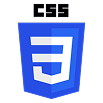
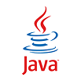
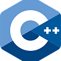
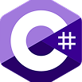
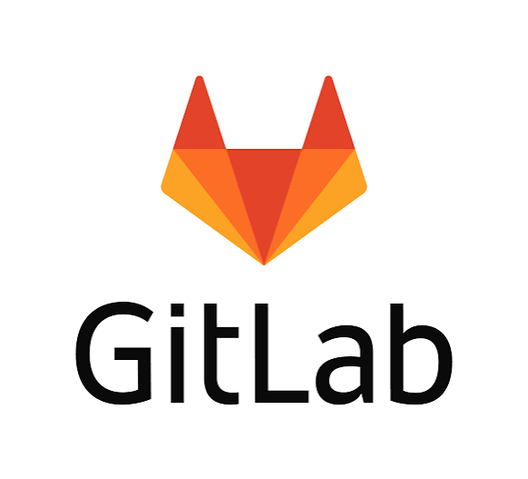

  

  <h3>🐍 Python Developer | Website Developer | Game Developer</h3>

<h2 align="center">About Me</h2>

  Hi! Welcome to my code space — where ideas turn into functional projects.
  I work with HTML, CSS, JavaScript, Python, C++, Java, and C#,
  exploring new technologies and building websites and applications.
  Always learning, always coding, and always looking for new challenges. 🚀

<h2 align="center">🛠️ Technologies & Tools</h2>

  
  
  
  
  
  
  
  

 

<h2 align="center">💻 Development Environment</h2>

| Category | Technologies |
|:---:|:---|
| **Programming** | Python · C++ · Java · C# |
| **Web Development** | HTML · CSS · JavaScript |
| **Operating Systems** | Windows · Linux · Ubuntu |
| **Version Control** | Git · GitLab |

