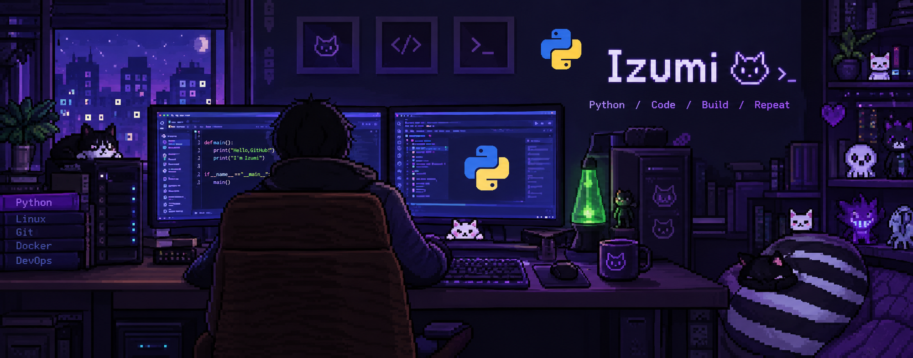

  

<h3 align="center">🐍 Python Developer | Website Developer | Game Developer</h3>

  <h3 align="center">About me</h3>

<h5>Hi! Welcome to my code space — where ideas turn into functional projects. I work with HTML, CSS, JavaScript, Python, C++, Java, and C#, exploring new technologies and building websites and applications. Always learning, always coding, and always looking for new challenges. 🚀 

  

        
        
        
        
        
        
        
        
        
        
        
  

 
Development 
├── Python 
├── C++ 
├── Java 
├── C# 
└── HTML / CSS / JavaScript 
 
Systems 
├── Windows 
└── Linux / Ubuntu 
</h5>

